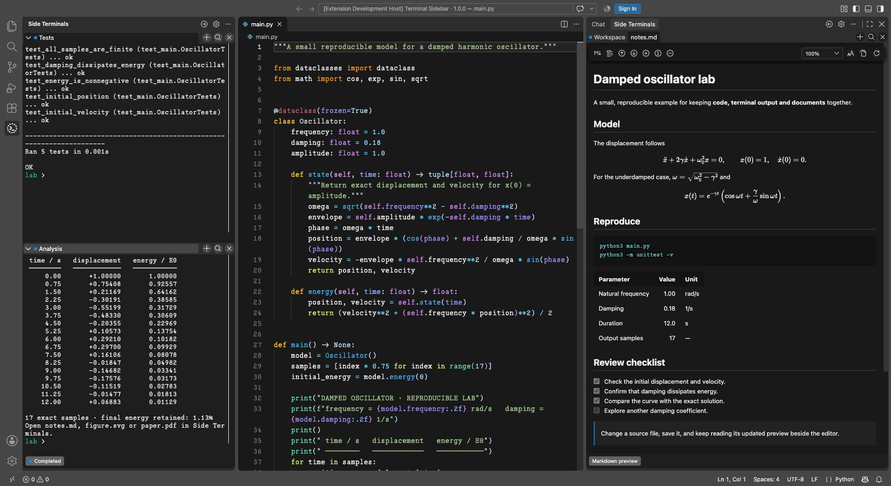
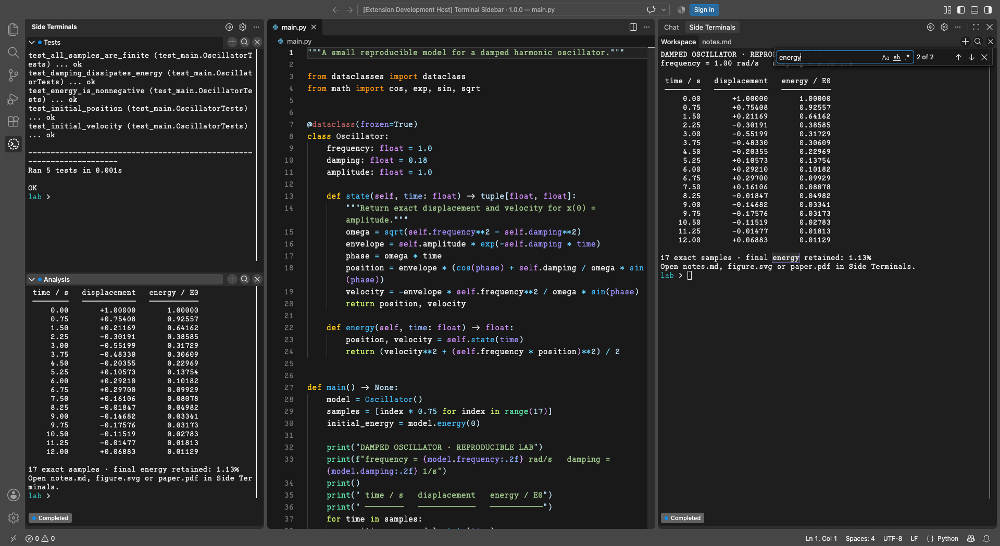
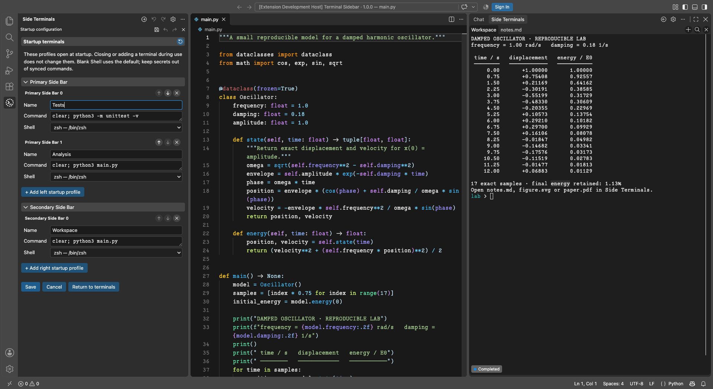
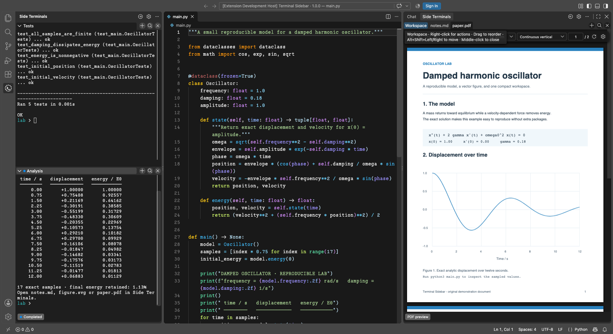
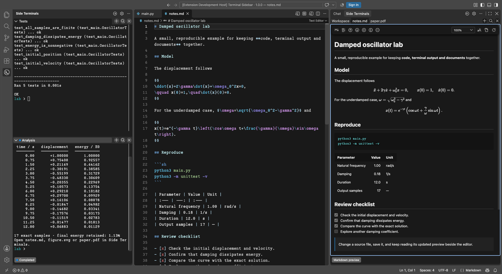
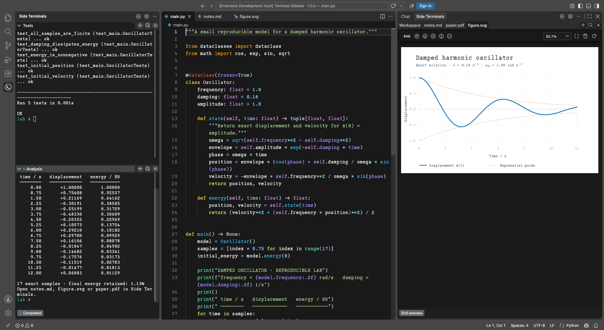

# Terminal Sidebar

**English** · [简体中文](https://github.com/Photonico/terminal_sidebar/blob/main/docs/readme_zh.md) · [日本語](https://github.com/Photonico/terminal_sidebar/blob/main/docs/readme_ja.md)

   

Independent terminals and document previews in VS Code. The **Primary Side Bar** uses collapsible sections; the **Secondary Side Bar** uses a compact tab strip. Keep Vim, Neovim, or another command-line tool beside its output and preview.

Version **1.0.0** is a stable release. Requires VS Code **1.106+** on desktop or a remote extension host. No separate Node.js installation is needed to use the extension.

The screenshots show the extension running in VS Code with the [Photonico Code](https://github.com/Photonico/Photonico_Code) font and the [Photonica](https://marketplace.visualstudio.com/items?itemName=ConAntares.photonica) theme.

## Get started

1. Install **Terminal Sidebar** from the [Visual Studio Marketplace](https://marketplace.visualstudio.com/items?itemName=ConAntares.terminal-sidebar), or install a platform-matched VSIX from [GitHub Releases](https://github.com/Photonico/terminal_sidebar/releases) through **Extensions: Install from VSIX…**.
2. Open **Side Terminals** and select **+** for a shell. The arrow button opens the other side bar.
3. Select the gear to configure startup terminals. Closing a terminal keeps its startup profile.
4. Use **Preview in Sidebar Terminal** in the editor title bar for SVG, EPS, PostScript, PDF, Markdown, LaTeX, HTML, CSS, JSON, or JSONC. LaTeX opens an existing compiled PDF; build with your usual tools first.

## Screenshots and everyday workflows

### Terminals and search

Run independent shells beside your editor. Use **Cmd+F / Ctrl+F** to search retained terminal output without sending the search text to the shell. The find controls support case-sensitive, whole-word, and regular-expression searches.

### Startup profiles

Use the configuration gear to choose the terminals opened on each side. Give a profile a name, command, shell, optional arguments, and environment values; closing a running tab keeps its startup profile for the next session.

### PDF and LaTeX reading

Keep a PDF beside its source. The toolbar offers vertical and horizontal continuous scrolling, single-page and two-page modes, zoom, page navigation, and dark reading. Saved PDFs refresh automatically; LaTeX opens your existing compiled PDF.

### Markdown with math

Read rendered headings, task lists, footnotes, and KaTeX formulas while editing Markdown. The preview has an outline, text search, zoom, and a font selector whose preference follows Settings Sync.

### SVG, EPS, and PostScript figures

View SVG as a vector image, zoom in for detail, or fit the image to the sidebar. EPS and PostScript use the PDF reader after conversion by Ghostscript. Saving the source refreshes the preview; **Save a copy…** keeps its original format.

## More features

- Saving a document refreshes its preview, including saves from Vim/NeoVim. PDFs offer vertical/horizontal continuous scrolling and single/two-page layouts beside the zoom menu, with arrow-key navigation and remembered reading positions.
- SVG previews retain vector detail when zooming and need no extra software. EPS (`.eps`) and PostScript (`.ps`) use the PDF viewer after conversion by **Ghostscript**, installed on the local or remote extension host. Set `terminalSidebar.ghostscriptPath` to its absolute executable path if automatic discovery fails. Conversion requires a trusted workspace and leaves the source unchanged.
- Markdown supports common syntax, task lists, footnotes, and KaTeX math. **Change preview font** defaults to **Default**; your choice follows VS Code Settings Sync.
- Preview static HTML with local assets, or formatted CSS/JSON/JSONC source. HTML scripts and forms remain inactive.
- **Cmd+F / Ctrl+F** searches terminal buffers and document text, with case, whole-word, regex, counts, and highlighting. Right-click the search button to search all open tabs on both sides. PDF search requires a text layer.
- Double-click a PDF location to return to its LaTeX source through **SyncTeX**. Compile with `-synctex=1` and install `synctex`.
- Drag tabs to reorder; right-click for actions. Export terminal output as HTML, PDF, Markdown, or plain text.
- **Change tab marker** selects a themed icon. Startup-profile icons follow the same profile across repositories. Document icons follow the same file. Temporary-terminal icons stay workspace-local.

## Keep in mind

Reloading VS Code creates new shell processes. Directory memory and command status depend on shell integration and are best effort. Startup settings can sync: **do not store credentials in commands, arguments, or environment values**.

[User and development guide](https://github.com/Photonico/terminal_sidebar/blob/main/docs/guide.md) · [Changelog](CHANGELOG.md) · [Issues](https://github.com/Photonico/terminal_sidebar/issues)

Design and maintenance: [Lu Niu (Photonico)](https://github.com/Photonico). Implementation, testing, and documentation assistance: **OpenAI Codex** and **Anthropic Claude**.

[MIT](LICENSE) © 2026 Lu Niu (Photonico). Bundled Codicons: Microsoft, [CC BY 4.0](https://creativecommons.org/licenses/by/4.0/).
