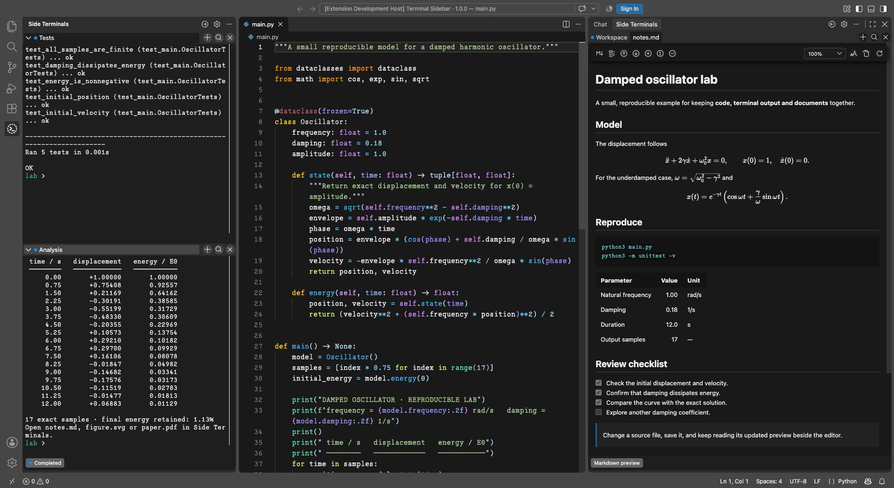
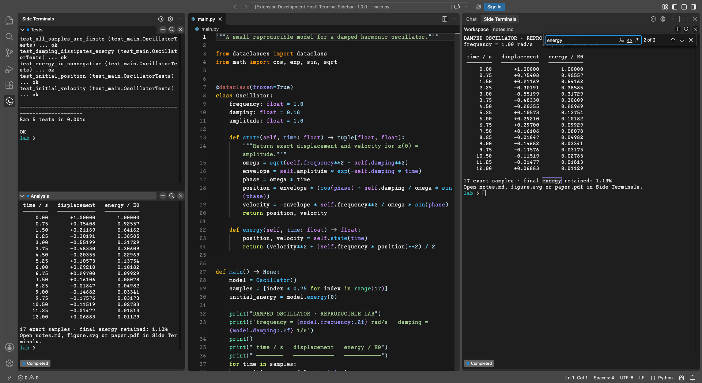
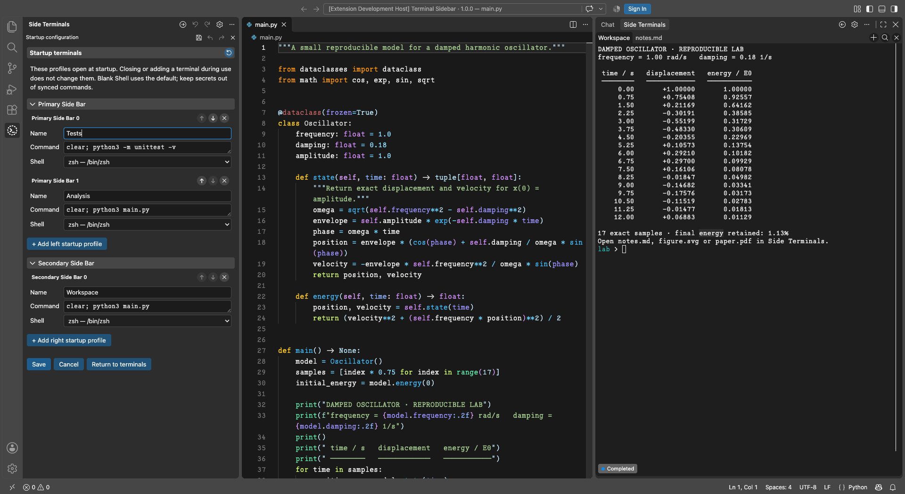
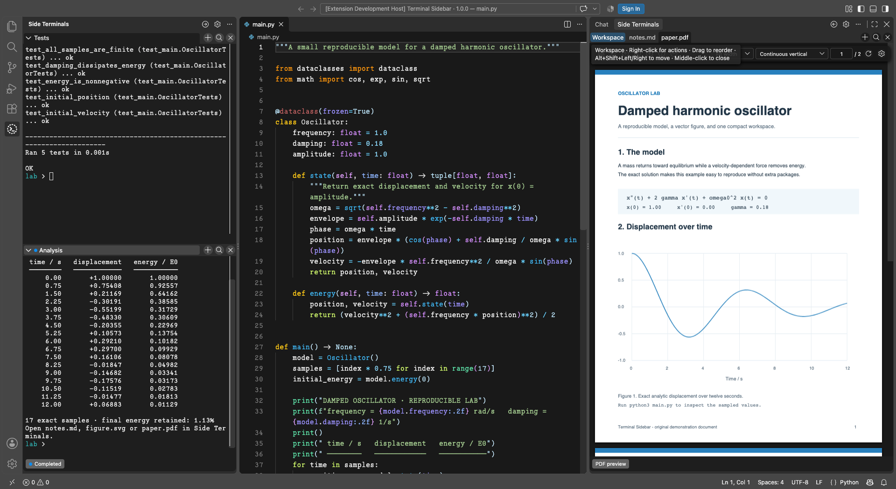
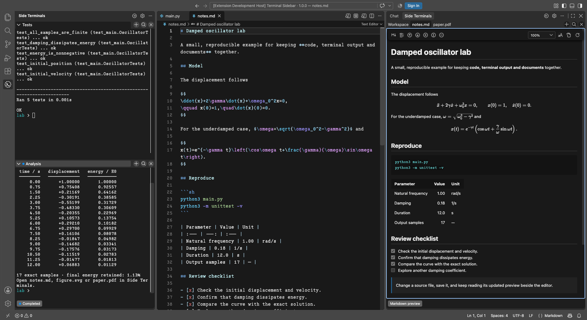
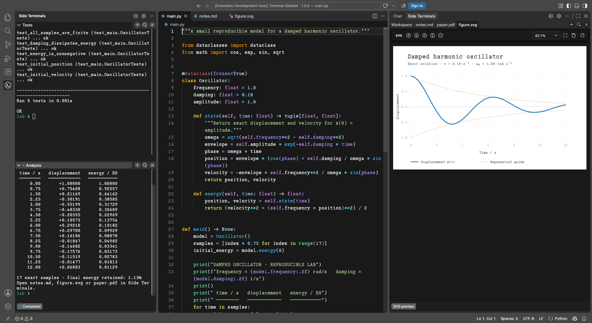

# Terminal Sidebar

[English](https://github.com/Photonico/terminal_sidebar/blob/main/README.md) · [简体中文](https://github.com/Photonico/terminal_sidebar/blob/main/docs/readme_zh.md) · **日本語**

   

VS Code のサイドバーで、独立したターミナルとドキュメントのプレビューを使えます。**Primary Side Bar（プライマリ サイド バー）**は折りたたみ式、**Secondary Side Bar（セカンダリ サイド バー）**はコンパクトなタブ形式です。Vim や Neovim などのコマンドラインツールと、実行結果やプレビューを並べて作業できます。

バージョン **1.0.0** は正式版です。VS Code **1.106 以降**のデスクトップ版、またはリモート拡張機能ホストが必要です。拡張機能の利用に Node.js の別途インストールは不要です。

以下は、拡張機能を実際に動かしている VS Code のスクリーンショットです。フォントは [Photonico Code](https://github.com/Photonico/Photonico_Code)、テーマは [Photonica](https://marketplace.visualstudio.com/items?itemName=ConAntares.photonica) を使用しています。

## はじめに

1. [Visual Studio Marketplace](https://marketplace.visualstudio.com/items?itemName=ConAntares.terminal-sidebar) から **Terminal Sidebar** をインストールします。[GitHub Releases](https://github.com/Photonico/terminal_sidebar/releases) の環境に合った VSIX を **Extensions: Install from VSIX…** でインストールすることもできます。
2. **Side Terminals** を開き、**+** でターミナルを作成します。矢印ボタンで反対側のビューを開けます。
3. 歯車ボタンで起動時のターミナルを設定します。ターミナルを閉じても、その起動プロファイルは削除されません。
4. エディターのタイトルバーにある **Preview in Sidebar Terminal** で SVG、EPS、PostScript、PDF、Markdown、LaTeX、HTML、CSS、JSON、JSONC をプレビューできます。LaTeX はコンパイル済みの PDF を表示するため、先に普段のツールでビルドしてください。

## スクリーンショットと使い方

### ターミナルと検索

エディターの横で独立したシェルを使えます。**Cmd+F / Ctrl+F** で保持された出力を検索でき、大文字と小文字の区別、単語単位、正規表現に対応します。検索語はシェルに送信しません。

### 起動プロファイル

歯車ボタンから、左右それぞれの起動ターミナルを設定します。名前、コマンド、シェル、任意の引数や環境変数を指定でき、実行中のタブを閉じても起動プロファイルは残ります。

### PDF と LaTeX の閲覧

PDF をソースと並べて読めます。ツールバーで縦／横の連続スクロール、単ページ／見開き、ズーム、ページ移動、ダーク表示を選べます。保存すると更新され、LaTeX では既存のコンパイル済み PDF を開きます。

### Markdown と数式

Markdown を編集しながら、見出し、タスクリスト、脚注、KaTeX 数式を確認できます。アウトライン、テキスト検索、ズーム、Settings Sync に対応したフォント選択も使えます。

### SVG・EPS・PostScript の図

SVG をベクター画像として表示し、細部の拡大やサイドバーへのフィットができます。EPS と PostScript は Ghostscript で変換した後、PDF ビューアーで表示します。保存すると更新され、**Save a copy…** では元の形式を保ちます。

## その他の機能

- Vim などでドキュメントを保存すると、プレビューが自動更新されます。PDF はズームメニューの横で縦／横の連続スクロール、単ページ／見開きを選べ、矢印キーでの移動と閲覧位置の保存に対応しています。
- SVG はベクター画像として表示し、拡大しても細部を保ちます。追加ソフトは不要です。EPS（`.eps`）と PostScript（`.ps`）は、ローカルまたはリモートの拡張機能ホストにインストールした **Ghostscript** で変換し、PDF ビューアーで表示します。自動検出できない場合は `terminalSidebar.ghostscriptPath` に実行ファイルの絶対パスを指定してください。変換には信頼済みワークスペースが必要で、元のファイルは変更しません。
- Markdown は一般的な構文、タスクリスト、脚注、KaTeX 数式に対応しています。**Change preview font** の初期値は **Default**。フォントの選択は VS Code Settings Sync で同期できます。
- HTML はローカルの画像やスタイルを使う静的ページとして表示し、CSS・JSON・JSONC はソースを整形して表示します。HTML のスクリプトやフォームは動作しません。
- **Cmd+F / Ctrl+F** でターミナルのバッファとドキュメントの文字を検索できます。大文字と小文字の区別、単語単位の検索、正規表現、件数表示、ハイライトに対応しています。検索ボタンの右クリックで、両側の開いているタブをまとめて検索できます。PDF の検索にはテキスト層が必要です。
- PDF 内をダブルクリックすると、**SyncTeX** で LaTeX ソースの対応箇所に戻れます。`-synctex=1` を付けてコンパイルし、`synctex` 実行ファイルをインストールしてください。
- タブをドラッグして並べ替え、右クリックで操作メニューを開けます。ターミナルの出力は HTML、PDF、Markdown、プレーンテキストに書き出せます。
- **Change tab marker** で、テーマに連動するタブアイコンを選べます。同じ起動プロファイルのアイコンは別のリポジトリでも引き継がれます。ドキュメントのアイコンは同じファイルに引き継がれます。一時的なターミナルのアイコンはワークスペースごとに保存されます。

## ご利用にあたって

VS Code を再読み込みすると、シェルは新しいプロセスとして起動します。作業ディレクトリの復元とコマンドの状態検出はシェル統合に依存し、常に取得できるとは限りません。起動設定は同期される場合があります。**コマンド、引数、環境変数に認証情報を保存しないでください。**

[使い方・開発ガイド（英語）](https://github.com/Photonico/terminal_sidebar/blob/main/docs/guide.md) · [変更履歴](https://github.com/Photonico/terminal_sidebar/blob/main/CHANGELOG.md) · [問題を報告](https://github.com/Photonico/terminal_sidebar/issues)

設計・メンテナンス：[Lu Niu (Photonico)](https://github.com/Photonico)。実装・テスト・ドキュメント作成支援：**OpenAI Codex**、**Anthropic Claude**。

[MIT](https://github.com/Photonico/terminal_sidebar/blob/main/LICENSE) © 2026 Lu Niu (Photonico)。同梱の Codicons は Microsoft によるもので、[CC BY 4.0](https://creativecommons.org/licenses/by/4.0/) ライセンスが適用されます。
