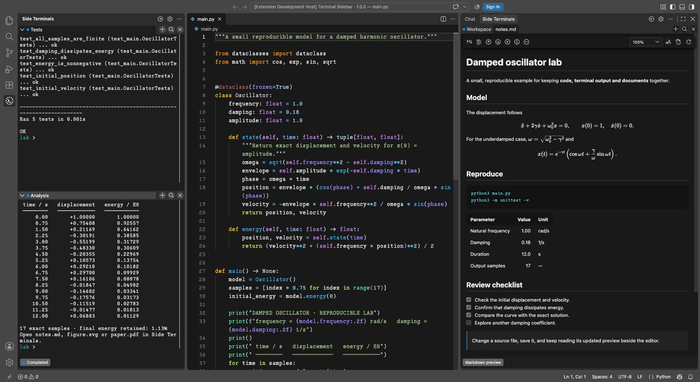
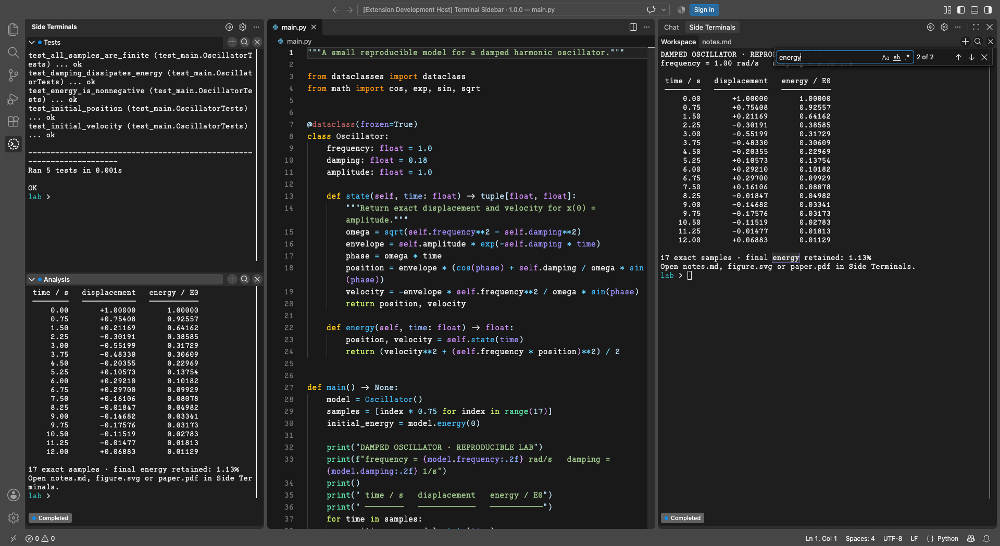
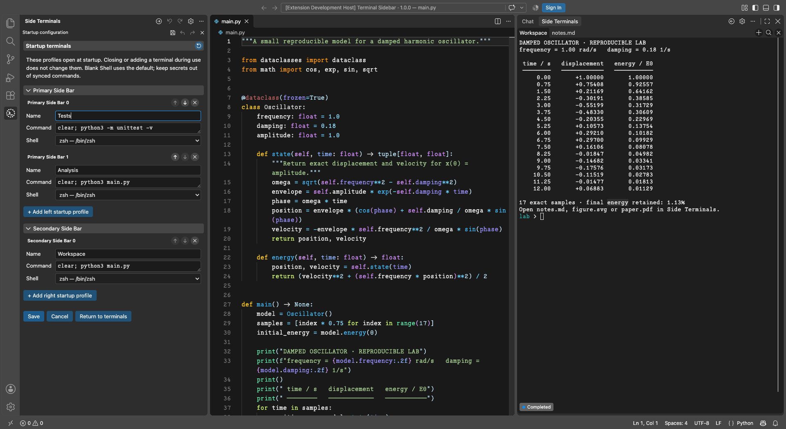
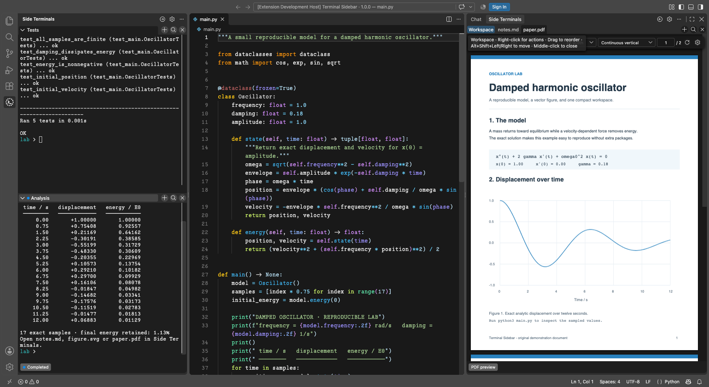
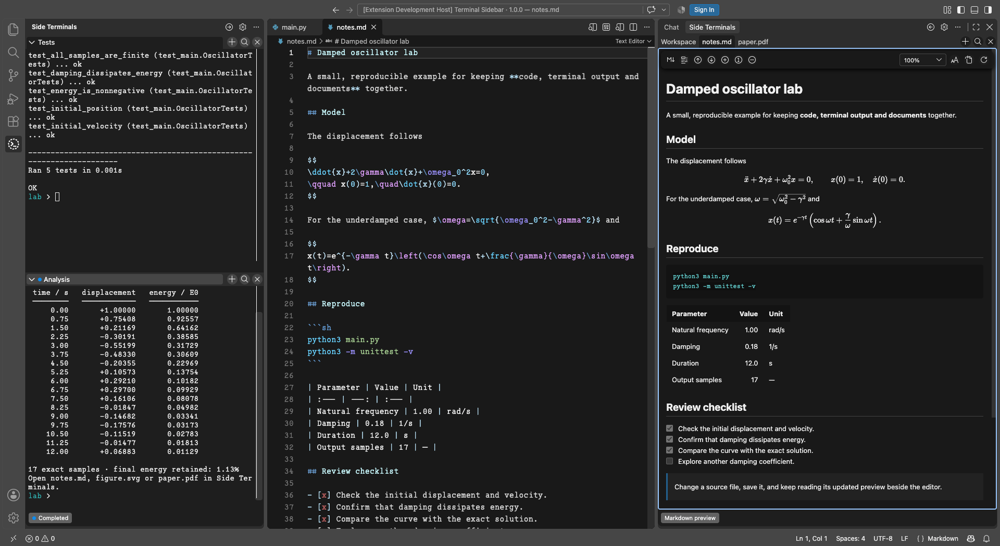
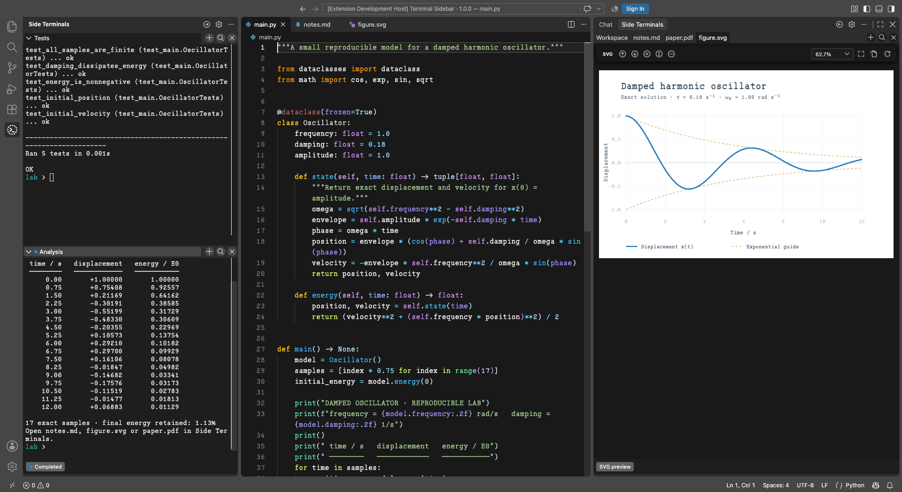

# Terminal Sidebar

[English](https://github.com/Photonico/terminal_sidebar/blob/main/README.md) · **简体中文** · [日本語](https://github.com/Photonico/terminal_sidebar/blob/main/docs/readme_ja.md)

   

在 VS Code 侧栏中使用独立终端和文档预览。**Primary Side Bar（主侧栏）**采用可折叠分区，**Secondary Side Bar（辅助侧栏）**采用紧凑的标签栏。让 Vim、Neovim 等命令行工具与运行结果、文档预览并排显示。

版本 **1.0.0** 为正式版。需要 VS Code **1.106+**，使用桌面版或远程扩展宿主。使用扩展无需单独安装 Node.js。

以下截图均截取自实际运行扩展的 VS Code，使用 [Photonico Code](https://github.com/Photonico/Photonico_Code) 字体和 [Photonica](https://marketplace.visualstudio.com/items?itemName=ConAntares.photonica) 主题。

## 快速开始

1. 在 [Visual Studio 扩展商店](https://marketplace.visualstudio.com/items?itemName=ConAntares.terminal-sidebar)安装 **Terminal Sidebar**；也可以从 [GitHub Releases](https://github.com/Photonico/terminal_sidebar/releases) 下载与扩展宿主平台匹配的 VSIX，再通过 **Extensions: Install from VSIX…** 安装。
2. 打开 **Side Terminals**，点击 **+** 创建终端。箭头按钮可以打开另一侧的终端视图。
3. 点击齿轮配置启动终端。关闭终端不会删除对应的启动配置。
4. 点击主编辑器标题栏的 **Preview in Sidebar Terminal**，预览 SVG、EPS、PostScript、PDF、Markdown、LaTeX、HTML、CSS、JSON 或 JSONC。LaTeX 使用已有的编译结果，请先用惯用工具生成 PDF。

## 截图与常用操作

### 终端与搜索

在编辑器旁运行独立的 shell。按 **Cmd+F / Ctrl+F** 搜索保留的终端输出，支持区分大小写、全字匹配和正则表达式，搜索内容不会发送给 shell。

### 启动配置

点击齿轮，为两侧分别设置启动终端，填写名称、命令、shell，以及可选参数和环境变量。关闭运行中的标签后，启动配置仍会保留。

### PDF 与 LaTeX 阅读

将 PDF 与源文件并排显示，在工具栏选择垂直／水平连续滚动、单页／双页模式、缩放、页码与暗色阅读。PDF 保存后自动刷新；LaTeX 使用已有的编译结果。

### Markdown 与公式

编辑 Markdown 的同时查看标题、任务列表、脚注和 KaTeX 数学公式。预览提供大纲、文字搜索、缩放和字体选择，字体偏好可以随 Settings Sync 同步。

### SVG、EPS 与 PostScript 图形

SVG 以矢量图显示，可以放大细节或适应侧栏大小。EPS 和 PostScript 由 Ghostscript 转换后使用 PDF 阅读器显示。保存源文件会自动刷新预览；**Save a copy…** 保留原格式。

## 更多功能

- 用 Vim 等编辑器保存文档后，预览会自动刷新。PDF 可在缩放菜单旁选择垂直／水平连续滚动、单页／双页模式，支持方向键导航及阅读位置记忆。
- SVG 以矢量图显示，放大保留细节，无需额外软件。EPS（`.eps`）和 PostScript（`.ps`）由本地或远程扩展宿主上的 **Ghostscript** 转换后，使用 PDF 阅读器显示。请在扩展宿主安装 Ghostscript；自动检测不到时，可用 `terminalSidebar.ghostscriptPath` 指定可执行程序的绝对路径。转换需要受信任的工作区，且不改写源文件。
- Markdown 支持常用语法、任务列表、脚注和 KaTeX 公式。**Change preview font** 默认为 **Default**；字体选择可随 VS Code Settings Sync 同步。
- HTML 以静态网页呈现，可加载本地资源；CSS、JSON、JSONC 显示格式化源码。HTML 中的脚本和表单不运行。
- 按 **Cmd+F / Ctrl+F** 搜索终端缓冲区和文档文字，支持区分大小写、全字匹配、正则表达式、结果计数和高亮。右键查找按钮可搜索两侧所有已打开的标签。PDF 搜索需要文本层。
- 双击 PDF 中的位置，通过 **SyncTeX** 跳回 LaTeX 源文件。需要以 `-synctex=1` 编译，并安装 `synctex` 可执行程序。
- 拖动标签可调整顺序，右键查看可用操作。终端输出可以导出为 HTML、PDF、Markdown 或纯文本。
- 用 **Change tab marker** 选择跟随主题的标签图标。同一启动配置的图标可跨仓库保留；文档图标跟随同一个文件；临时终端图标只保存在当前工作区。

## 使用须知

重新加载 VS Code 会创建新的 shell 进程。工作目录记忆和命令状态检测依赖 shell 集成，只能尽力恢复和判断。启动配置可能随设置同步：**请勿在命令、参数或环境变量中保存凭据**。

[使用与开发指南（英文）](https://github.com/Photonico/terminal_sidebar/blob/main/docs/guide.md) · [更新记录](https://github.com/Photonico/terminal_sidebar/blob/main/CHANGELOG.md) · [问题反馈](https://github.com/Photonico/terminal_sidebar/issues)

设计与维护：[Lu Niu (Photonico)](https://github.com/Photonico)。实现、测试与文档协助：**OpenAI Codex** 与 **Anthropic Claude**。

[MIT](https://github.com/Photonico/terminal_sidebar/blob/main/LICENSE) © 2026 Lu Niu (Photonico)。内置 Codicons 由 Microsoft 提供，采用 [CC BY 4.0](https://creativecommons.org/licenses/by/4.0/) 许可。
